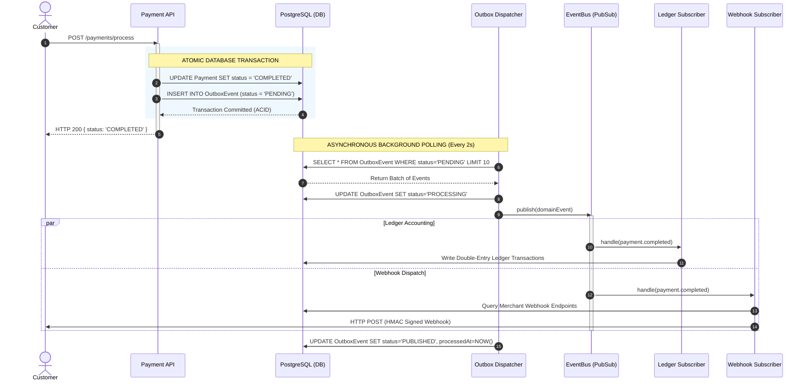
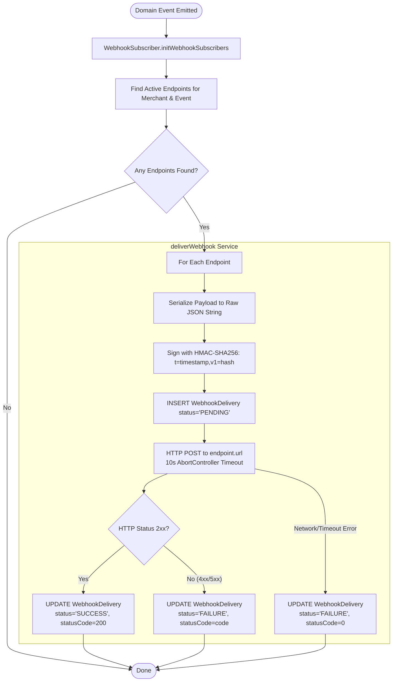

# Architecture Guide: Event-Driven Architecture, Transactional Outbox, & Webhook Systems

> A comprehensive deep-dive into the architectural evolution of **FinPay**: transitioning from a synchronous Modular Monolith to an **Event-Driven Architecture (EDA)**, dissecting the **Transactional Outbox Pattern**, exploring **Enterprise Webhook Delivery**, and preparing for **Senior/Staff System Design Interviews**.

---

## Table of Contents
1. [From Modular Monolith to Event-Driven Architecture](#1-from-modular-monolith-to-event-driven-architecture)
   - [The Problem with Synchronous In-Process Coupling](#the-problem-with-synchronous-in-process-coupling)
   - [The Dual-Write Problem Explained](#the-dual-write-problem-explained)
   - [The Solution: Transactional Outbox Pattern](#the-solution-transactional-outbox-pattern)
   - [End-to-End Code Flow & Execution Trace](#end-to-end-code-flow--execution-trace)
   - [Visual Flowchart: Transactional Outbox & Event Dispatch](#visual-flowchart-transactional-outbox--event-dispatch)
2. [Deep Dive: Webhook Subsystem Architecture](#2-deep-dive-webhook-subsystem-architecture)
   - [Why Webhooks (Push vs. Pull)](#why-webhooks-push-vs-pull)
   - [Security Architecture: HMAC-SHA256 & Anti-Replay Defense](#security-architecture-hmac-sha256--anti-replay-defense)
   - [TypeScript Concepts & Design Patterns Employed](#typescript-concepts--design-patterns-employed)
   - [Visual Flowchart: Webhook Delivery Lifecycle](#visual-flowchart-webhook-delivery-lifecycle)
3. [Senior & Staff Engineer Interview Preparation](#3-senior--staff-engineer-interview-preparation)
   - [Question 1: The Dual-Write Problem & The Outbox Pattern](#question-1-the-dual-write-problem--the-outbox-pattern)
   - [Question 2: At-Least-Once Delivery vs. Exactly-Once Processing](#question-2-at-least-once-delivery-vs-exactly-once-processing)
   - [Question 3: Polling Outbox vs. Change Data Capture (CDC / Debezium)](#question-3-polling-outbox-vs-change-data-capture-cdc--debezium)
   - [Question 4: Webhook Security, Replay Attacks, and SSRF Hardening](#question-4-webhook-security-replay-attacks-and-ssrf-hardening)
   - [Question 5: Strangler Fig Pattern & Monolith-to-Microservices Migration](#question-5-strangler-fig-pattern--monolith-to-microservices-migration)

---

## 1. From Modular Monolith to Event-Driven Architecture

### The Problem with Synchronous In-Process Coupling

In Phase 1 and early Phase 2, our system processed actions synchronously within a single HTTP request lifecycle. For example, when a customer initiated a payment:

```text
HTTP POST /payments
  └── PaymentService.processPayment()
        ├── Step 1: Insert Payment Record (DB)
        ├── Step 2: Direct call to LedgerService.recordPayment() (DB)
        ├── Step 3: Direct call to WebhookService.sendWebhook() (Network HTTP)
        └── Step 4: Return HTTP 201 to Client
```

This synchronous direct invocation created severe architectural anti-patterns:
1. **Cascading Failure & Blast Radius:** If a merchant’s external webhook URL hung or threw a 500 error, the payment request would either timeout, fail, or leave the customer waiting 10+ seconds.
2. **Thread/Connection Starvation:** Web requests held open database connections while waiting on third-party network egress.
3. **Tight Coupling:** The `payments` module had to know about every downstream system interested in payment completions (`ledgers`, `webhooks`, analytics, email notifications). Adding a new downstream consumer required editing the payment service.

### The Dual-Write Problem Explained

A common novice architectural mistake is attempting to make operations asynchronous simply by emitting an event after saving to the database:

```typescript
// ANTI-PATTERN: The Dual-Write Problem
await prisma.payment.update({ where: { id }, data: { status: "COMPLETED" } });
await messageBroker.publish("payment.completed", paymentData); // WHAT IF THIS FAILS?
```

This leads to the notorious **Dual-Write Problem**: you are writing to **two different storage systems** (PostgreSQL and a Message Broker/Event Bus) without an atomic distributed transaction. Two critical failure modes occur:

| Scenario | What Happens | Result |
| :--- | :--- | :--- |
| **Failure Mode A** | DB write succeeds, but Message Broker/App crashes before event publish. | **Silent Inconsistency:** Payment is `COMPLETED`, but Ledger is never credited, Webhook is never sent, and merchant never fulfills customer goods. |
| **Failure Mode B** | Event is published first, but DB write fails/rolls back. | **Phantom Execution:** Downstream services act on an event for a payment that does not exist in the database. |

Two-Phase Commit (2PC / XA transactions) across databases and message queues is notoriously brittle, slow, and unsupported by modern cloud systems.

### The Solution: Transactional Outbox Pattern

The **Transactional Outbox Pattern** solves the Dual-Write problem cleanly by leveraging **local ACID transactions** within a single relational database.

Instead of writing to the database and publishing to an event broker as two disconnected operations:
1. The business mutation (`Payment` state change) and an event record (`OutboxEvent`) are inserted **within the exact same database transaction (`tx`)**.
2. If the transaction commits, both records persist. If it rolls back, neither persists. **Inconsistency is mathematically impossible at this stage.**
3. A decoupled background process (**Outbox Dispatcher**) continuously reads pending outbox events and pushes them to downstream consumers.

```text
[HTTP Request] ──────────────────────────┐
                                          │ Atomic Local Transaction
                                          ▼
                         ┌─────────────────────────────────┐
                         │      PostgreSQL (ACID tx)       │
                         │  1. INSERT INTO "Payment"       │
                         │  2. INSERT INTO "OutboxEvent"   │
                         └─────────────────────────────────┘
                                          │
    ┌─────────────────────────────────────┴─────────────────────────────────────┐
    │ (Asynchronous & Decoupled)                                                │
    ▼                                                                           ▼
┌─────────────────────────┐                                           ┌──────────────────┐
│ Outbox Dispatcher       │ ──> Reads PENDING ──> Emits to Event Bus  │ Ledger Subscriber│
│ (Background Poller)     │     Marks PUBLISHED                        └──────────────────┘
└─────────────────────────┘                                                     │
                                                                                ▼
                                                                      ┌──────────────────┐
                                                                      │Webhook Subscriber│
                                                                      └──────────────────┘
```

---

### End-to-End Code Flow & Execution Trace

Here is the exact code execution path implemented in the FinPay codebase:

#### Step 1: Atomic Outbox Insertion in Business Transaction
File: [payment.service.ts](file:///Volumes/Work/learning/finpay/src/modules/payments/payment.service.ts) and [outbox.helper.ts](file:///Volumes/Work/learning/finpay/src/shared/events/outbox.helper.ts)

When a payment succeeds, `insertOutboxEvent` runs on the **same Prisma Transaction Client (`tx`)**:

```typescript
// src/modules/payments/payment.service.ts
const result = await prisma.$transaction(async (tx) => {
  // 1. Update business entity
  const updatedPayment = await tx.payment.update({
    where: { id: payment.id },
    data: { status: PaymentStatus.COMPLETED },
  });

  // 2. Queue domain event atomically in outbox table
  await insertOutboxEvent(tx, {
    eventType: "payment.completed",
    aggregateType: "Payment",
    aggregateId: payment.id,
    payload: {
      paymentId: payment.id,
      merchantId: payment.merchantId,
      amount: payment.amount.toString(),
      currency: payment.currency,
    },
  });

  return updatedPayment;
});
```

#### Step 2: The Outbox Helper
File: [outbox.helper.ts](file:///Volumes/Work/learning/finpay/src/shared/events/outbox.helper.ts)

```typescript
export async function insertOutboxEvent(
  tx: Prisma.TransactionClient,
  event: DomainEvent
) {
  return tx.outboxEvent.create({
    data: {
      aggregateType: event.aggregateType,
      aggregateId: event.aggregateId,
      eventType: event.eventType,
      payload: event.payload as any,
      status: OutboxStatus.PENDING,
    },
  });
}
```

#### Step 3: The Outbox Dispatcher
File: [outbox.dispatcher.ts](file:///Volumes/Work/learning/finpay/src/shared/events/outbox.dispatcher.ts)

Started in [server.ts](file:///Volumes/Work/learning/finpay/src/server.ts), this worker polls every 2 seconds:
1. Queries `OutboxEvent` records where `status = "PENDING"` with `take: 10` ordered by `createdAt ASC`.
2. Marks the records as `PROCESSING` to prevent duplicate processing by concurrent loops.
3. Invokes `await eventBus.publish(domainEvent)`.
4. On success, updates `status = "PUBLISHED"` and sets `processedAt`.
5. On failure, increments `retryCount`, stores `errorMessage`, and sets status to `FAILED` after 3 failed attempts.

```typescript
export async function processOutboxBatch(): Promise<number> {
  const events = await prisma.outboxEvent.findMany({
    where: { status: OutboxStatus.PENDING },
    orderBy: { createdAt: "asc" },
    take: BATCH_SIZE,
  });

  for (const record of events) {
    await prisma.outboxEvent.update({
      where: { id: record.id },
      data: { status: OutboxStatus.PROCESSING },
    });

    try {
      await eventBus.publish({
        aggregateType: record.aggregateType as any,
        aggregateId: record.aggregateId,
        eventType: record.eventType as any,
        payload: record.payload as any,
      });

      await prisma.outboxEvent.update({
        where: { id: record.id },
        data: { status: OutboxStatus.PUBLISHED, processedAt: new Date() },
      });
    } catch (error: any) {
      await prisma.outboxEvent.update({
        where: { id: record.id },
        data: {
          status: record.retryCount >= 3 ? OutboxStatus.FAILED : OutboxStatus.PENDING,
          retryCount: { increment: 1 },
          errorMessage: error?.message || "Unknown error",
        },
      });
    }
  }
}
```

#### Step 4: Downstream Asynchronous Handlers
Subscribers react autonomously without the Payment module knowing they exist:
- **LedgerSubscriber** ([ledger.subscriber.ts](file:///Volumes/Work/learning/finpay/src/modules/ledgers/ledger.subscriber.ts)): Listens for `payment.completed` and `refund.completed`, updating the double-entry accounting balances.
- **WebhookSubscriber** ([webhook.subscriber.ts](file:///Volumes/Work/learning/finpay/src/modules/webhooks/webhook.subscriber.ts)): Queries active merchant endpoints, signs cryptographic payloads, and dispatches HTTP requests.

---

### Visual Flowchart: Transactional Outbox & Event Dispatch



---

## 2. Deep Dive: Webhook Subsystem Architecture

### Why Webhooks (Push vs. Pull)

In financial integrations, merchants need to know when payment states change (e.g., async asynchronous APMs like Pix, ACH, or 3D-Secure card authorizations).
- **The Polling Antipattern (Pull):** 10,000 merchants polling `GET /payments/:id` every 5 seconds generates 2,000 requests/sec of wasted network I/O and database compute where 99.9% of responses say "still pending".
- **Webhooks (Push):** FinPay sends an HTTP POST directly to the merchant's callback URL the millisecond the event is finalized.

---

### Security Architecture: HMAC-SHA256 & Anti-Replay Defense

Webhooks travel over the public internet. A production webhook system must satisfy two fundamental security mandates:
1. **Authenticity & Integrity:** The merchant must be certain the request was sent by FinPay and was not altered in transit.
2. **Anti-Replay Defense:** An eavesdropper must not be able to capture a valid webhook request and replay it later (e.g., replaying a `payment.completed` webhook to double-credit user credits).

#### How FinPay Implements the Stripe-Standard HMAC Protocol:
File: [webhook.crypto.ts](file:///Volumes/Work/learning/finpay/src/modules/webhooks/webhook.crypto.ts)

```typescript
export function signWebhookPayload(payload: string, secret: string): string {
  const timestamp = Math.floor(Date.now() / 1000);
  const payloadToSign = `${timestamp}.${payload}`;
  const hmac = crypto
    .createHmac("sha256", secret)
    .update(payloadToSign)
    .digest("hex");
  return `t=${timestamp},v1=${hmac}`;
}
```

#### How the Signature Works:
1. A shared secret (`whs_<64-hex-chars>`) is uniquely generated per endpoint via `crypto.randomBytes(32).toString('hex')`.
2. A Unix timestamp (seconds) is prepended to the raw JSON string: `payloadToSign = "${timestamp}.${rawBody}"`.
3. We compute an `HMAC-SHA256` of `payloadToSign` using the secret key.
4. The header `X-FinPay-Signature: t=1727163653,v1=5f3d...` is sent alongside the payload.

#### How Merchants Verify (and Prevent Replay Attacks):
1. **Extract `t` and `v1`** from `X-FinPay-Signature`.
2. **Tolerance Check (Anti-Replay):** Compare `Math.abs(currentTime - t)`. If greater than 300 seconds (5 minutes), **reject the request**. Attackers cannot reuse intercepted requests after 5 minutes.
3. **Recompute HMAC:** Compute `HMAC-SHA256("${t}.${rawReceivedBody}", secret)`.
4. **Constant-Time Comparison:** Compare signatures using `crypto.timingSafeEqual(computed, received)` to prevent **timing attacks**.

---

### TypeScript Concepts & Design Patterns Employed

The event and webhook architecture heavily exploits advanced TypeScript features to guarantee compile-time correctness:

#### 1. Discriminated Unions for Type Narrowing
File: [event.types.ts](file:///Volumes/Work/learning/finpay/src/shared/events/event.types.ts)

Every event shares a common discriminant key: `eventType`.

```typescript
export interface PaymentCompletedEvent {
  eventType: "payment.completed"; // <-- Discriminant
  aggregateType: "Payment";
  aggregateId: string;
  payload: PaymentCompletedPayload;
}

export interface PaymentFailedEvent {
  eventType: "payment.failed";    // <-- Discriminant
  aggregateType: "Payment";
  aggregateId: string;
  payload: PaymentFailedPayload;
}

export type DomainEvent = PaymentCompletedEvent | PaymentFailedEvent | PayoutCompletedEvent | RefundCompletedEvent;
```

*Benefit:* When code checks `if (event.eventType === "payment.completed")`, TypeScript automatically narrows `event.payload` to `PaymentCompletedPayload`. It is impossible to mistakenly access `failureReason` on a completed payment.

#### 2. Advanced Generics & Indexed Access Types
```typescript
export type DomainEventType = DomainEvent["eventType"];

// Uses the built-in Extract utility to dynamically find the payload matching eventType T
export type EventPayloadFor<T extends DomainEventType> = 
  Extract<DomainEvent, { eventType: T }>["payload"];
```

*Benefit:* Our `EventBus.subscribe` method is 100% type-safe:
```typescript
subscribe<T extends DomainEventType>(eventType: T, handler: (payload: EventPayloadFor<T>) => Promise<void>): void;
```
If you subscribe to `"payment.failed"`, TypeScript enforces that the callback `payload` has `failureReason: string`.

#### 3. Fault-Tolerant Native Fetch with `AbortController`
File: [webhook.service.ts](file:///Volumes/Work/learning/finpay/src/modules/webhooks/webhook.service.ts)

External merchant endpoints may hang indefinitely. We enforce a 10-second hard cancellation deadline using Node's standard `AbortController`:

```typescript
const controller = new AbortController();
const timeoutId = setTimeout(() => controller.abort(), 10000);

const response = await fetch(endpoint.url, {
  method: "POST",
  headers: {
    "Content-Type": "application/json",
    "X-FinPay-Signature": signature,
    "X-FinPay-Event": eventType,
  },
  body: payloadString,
  signal: controller.signal, // Triggers abort when timer fires
});
clearTimeout(timeoutId);
```

#### 4. Audit & Delivery Status State Tracking
Every attempt is recorded in `WebhookDelivery` with response status codes, truncated bodies (preventing database bloat), and error messages, providing full auditability for merchants and platform support.

---

### Visual Flowchart: Webhook Delivery Lifecycle



---

## 3. Senior & Staff Engineer Interview Preparation

### Question 1: The Dual-Write Problem & The Outbox Pattern

> **Interviewer:** *"We have a Payment Service that saves a transaction in PostgreSQL and then publishes an event to Apache Kafka / RabbitMQ so other teams can consume it. What is the fundamental flaw with this design, and how would you resolve it?"*

#### Ideal Candidate Answer:
"This is the classic **Dual-Write Problem**. In distributed systems, publishing to a message broker and writing to a database are two independent network operations with separate consensus protocols. There is no atomic guarantee between them.
- If the database write commits but the broker connection drops or the node crashes, you have a **lost event** (silent data inconsistency).
- If you publish the event first, but the database transaction rolls back due to a constraint violation, you have emitted a **phantom event**, triggering downstream actions for money that was never collected.

To solve this, I would implement the **Transactional Outbox Pattern**:
1. Within the **same local ACID database transaction** that modifies the payment state, we insert an event record into an `outbox` table.
2. Because this relies on local database ACID properties, either both the payment update and the outbox record commit, or both roll back.
3. A separate asynchronous relay process (either a polling worker or a Change Data Capture process) reads the outbox table and dispatches events to the message broker.
4. Once acknowledged by the broker, the outbox record is marked as published or deleted. This guarantees that events are **never lost**."

---

### Question 2: At-Least-Once Delivery vs. Exactly-Once Processing

> **Interviewer:** *"Does the Outbox Pattern provide Exactly-Once delivery? What happens if our outbox worker publishes an event to Kafka, but crashes before it updates the outbox table status from `PROCESSING` to `PUBLISHED`?"*

#### Ideal Candidate Answer:
"The Outbox Pattern provides **At-Least-Once Delivery**, NOT Exactly-Once delivery.
If the worker successfully publishes to Kafka, but crashes or loses network connectivity to PostgreSQL before committing the `PUBLISHED` status, the next recovery poll will re-fetch that outbox record and publish it a second time. 

In distributed systems over unreliable networks (per the *Two Generals Problem*), **true physical Exactly-Once delivery at the network layer is mathematically impossible**.

Therefore, the architectural responsibility shifts to the consumer: **consumers must be strictly Idempotent**.
To achieve **effective Exactly-Once processing**:
1. Every domain event must include a globally unique identifier (e.g., `eventId` or `aggregateId` + `version`).
2. When the consumer receives an event, it executes within an idempotent boundary:
   - In a SQL consumer: It checks a `processed_events` table or uses `INSERT INTO processed_events (event_id) VALUES (...) ON CONFLICT DO NOTHING`.
   - In a ledger consumer: The ledger transaction uses a unique constraint on `(source_event_id, account_id)`. If the duplicate arrives, the database rejects the duplicate insert without failing the pipeline.
Together, **At-Least-Once Delivery + Idempotent Consumer = Exactly-Once Processing Semantics**."

---

### Question 3: Polling Outbox vs. Change Data Capture (CDC / Debezium)

> **Interviewer:** *"In our current implementation, we poll the `outbox` table using `SELECT ... WHERE status = 'PENDING' LIMIT 10` every 2 seconds. When does this pattern break down at scale, and what is the production-grade alternative?"*

#### Ideal Candidate Answer:

| Dimension | Polling Worker (Current Implementation) | Change Data Capture (CDC / Debezium) |
| :--- | :--- | :--- |
| **How it works** | App runs `SELECT ... ORDER BY createdAt` at regular intervals (`setInterval`). | Reads database **Write-Ahead Log (WAL)** directly (e.g., PostgreSQL Logical Decoding). |
| **Latency** | Bounded by poll interval (e.g., up to 2,000ms delay). | Near real-time (sub-50ms streaming). |
| **Database Overhead** | High read contention; frequent index scans and lock contention on active tables. | Zero query overhead on the database engine; reads raw sequential transaction log files. |
| **Operational Complexity** | Very low; zero extra infrastructure, just application code. | High; requires running Kafka Connect, Debezium instances, schema registries, and WAL management. |

**Scale Threshold:**
"Polling is ideal for early-stage and moderate-throughput systems (up to hundreds of transactions per second). At hyper-scale (thousands of TPS), table polling causes database CPU spikes and table bloat from frequent `UPDATE` statements on PostgreSQL MVCC (VACUUM pressure). 

At that point, we upgrade the transport to **CDC (Change Data Capture)** using tools like **Debezium**:
- The application only inserts into the `outbox` table.
- Debezium tails PostgreSQL's Write-Ahead Log (`pg_wal`), captures the row insert instantly, and streams it into Kafka without running a single `SELECT` query against the database."

---

### Question 4: Webhook Security, Replay Attacks, and SSRF Hardening

> **Interviewer:** *"How do you secure outgoing webhooks against interception, replay attacks, and Server-Side Request Forgery (SSRF)?"*

#### Ideal Candidate Answer:
"A production webhook infrastructure requires a three-tier defense model:

#### 1. Payload Integrity & Authenticity (HMAC-SHA256)
We issue a unique secret to each registered merchant endpoint. When dispatching, we sign the payload with `HMAC-SHA256`. We prefix the signature with the Unix timestamp:
`X-FinPay-Signature: t=1727163653,v1=a84f...`
Merchants verify using constant-time comparison (`crypto.timingSafeEqual`) to prevent timing side-channel attacks.

#### 2. Anti-Replay Defense
By incorporating the timestamp into the signed payload (`${timestamp}.${rawJson}`), attackers cannot modify the timestamp without invalidating the cryptographic hash. The merchant inspects the timestamp and rejects any request where `|currentTime - t| > 300` seconds. Even if an attacker captures the packet, they cannot replay it 5 minutes later.

#### 3. SSRF (Server-Side Request Forgery) Hardening
Allowing users to enter arbitrary webhook URLs creates severe SSRF vulnerability: a malicious actor could register `http://169.254.169.254/latest/meta-data/` (AWS instance metadata) or `http://localhost:5432` to scan our internal network.
To mitigate this in production:
- **DNS Resolution & Private IP Blocklist:** Before dispatching, resolve the hostname to its IP address and reject requests resolving to private, loopback, or link-local ranges (`127.0.0.0/8`, `10.0.0.0/8`, `192.168.0.0/16`, `169.254.0.0/16`, `::1`).
- **Dedicated Egress Proxy:** Route all outbound webhook traffic through a hardened forward proxy (e.g., Smokescreen or Squid) in an isolated DMZ VPC with no route to internal infrastructure.
- **Disallow HTTP Redirects:** Disable automatic redirect following (`redirect: 'error'`) so an attacker cannot register a public URL that 302-redirects to an internal IP."

---

### Question 5: Strangler Fig Pattern & Monolith-to-Microservices Migration

> **Interviewer:** *"We have decided to extract the Webhook and Ledger capabilities from our Monolith into independent services. How do you execute this migration without causing downtime or breaking existing clients?"*

#### Ideal Candidate Answer:
"We execute this using Martin Fowler’s **Strangler Fig Pattern**: gradually replacing monolithic capabilities around the perimeter until the old code can be safely decommissioned.

```text
Step 1: Modular Monolith Boundary (Completed in Phase 2)
  └── Establish clean facades, isolated schemas, and domain events.

Step 2: Dual-Run / Event Tap (Phase 3 Hybrid)
  └── Stand up the Webhook Microservice as a separate process.
  └── Connect it to the event stream (Redis Streams / Kafka).
  └── The monolith stops delivering webhooks internally; it only publishes events.
  └── External traffic for registering endpoints is routed via API Gateway / Strangler Proxy.

Step 3: Database Severance (Ledger Extraction)
  └── Provision separate database: `finpay_ledger_db`.
  └── Sever relational foreign keys between Payment and Ledger.
  └── Migrate historical data with zero-downtime replication.
  └── Switch reads/writes to the new Ledger Service.

Step 4: Decommission Monolith Code
  └── Delete the old internal modules from the monolith codebase.
```

**Key Takeaways for Senior Roles:**
- Never perform a 'big bang' rewrite; migrate one bounded context at a time.
- Start with peripheral, asynchronous services (Webhooks) before extracting core, stateful database services (Ledgers).
- Maintain backward compatibility at the API gateway layer so clients are completely unaware of underlying architectural shifts."

---

## Summary Checklist for Architectural Review

- [x] **Zero Dual-Write Bugs:** Atomic outbox writes ensure 100% data consistency.
- [x] **Decoupled Asynchronous Processing:** Outbox Dispatcher frees HTTP worker threads from downstream work.
- [x] **Cryptographic Webhook Security:** Stripe-standard HMAC-SHA256 with timestamp anti-replay.
- [x] **Strict TypeScript Types:** Discriminated unions, generic type extractors, and runtime type narrowing.
- [x] **Clear Strangler Migration Path:** Ready to extract Webhook and Ledger services to autonomous microservices backed by Redis Streams.
